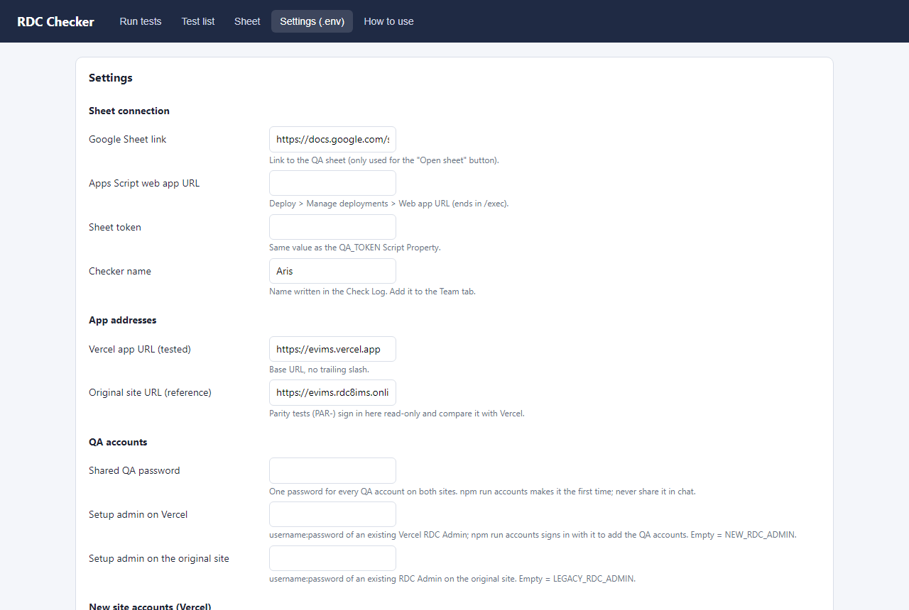
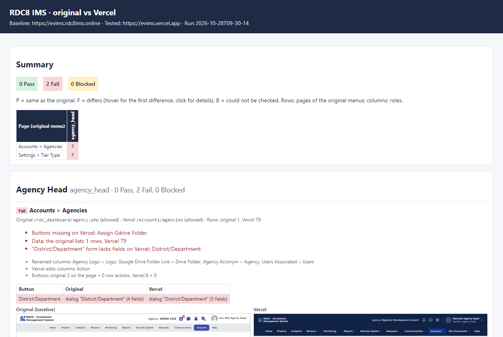
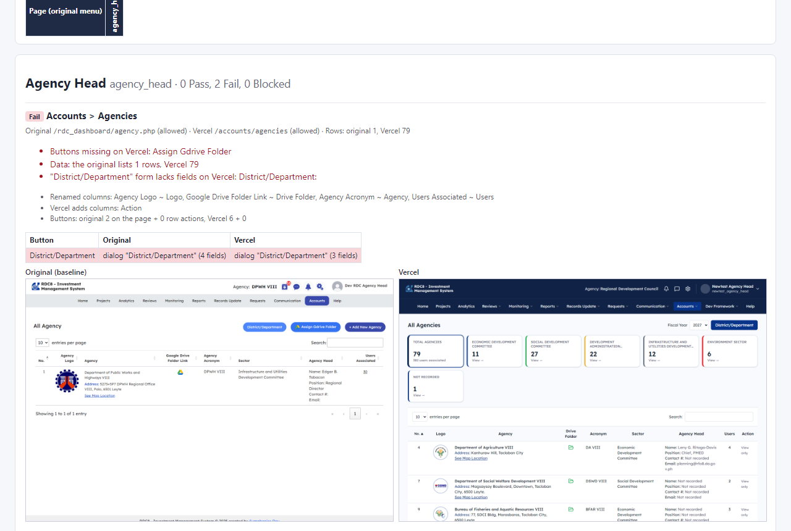

# Setting up the RDC Checker on a PC

The checker compares the **original site** (https://evims.rdc8ims.online, the baseline) with **Vercel**
(https://evims.vercel.app, the site under test). For every account type it checks:

- **access**: the role can open the same pages and is blocked from the same pages
- **layout**: every column, filter and button on the original is on Vercel
- **buttons**: clicking a button does the same thing on both sites (same form and fields, same page, or a download)
- **data**: each table holds the same number of rows
- **writes** (optional): on settings pages, adding a TEST- record, finding it and deleting it works the same on both

It writes a report with the two sites' screenshots side by side.

## 1. Install (once per PC)

You need **Node.js 20 or newer** and **Git**.

On Windows, run these in PowerShell:

```powershell
winget install OpenJS.NodeJS.LTS
winget install Git.Git
```

On macOS, install Homebrew first, then run:

```bash
brew install node git
```

Close the terminal and open a new one. Then get the checker and its browser:

```bash
git clone https://github.com/Aris-Artates/rdc-tester.git
cd rdc-tester
npm install
npm run setup
```

`npm run setup` downloads the Chromium browser the checker drives (about 150 MB).

## 2. Settings (`.env`)

Make your settings file from the example. On Windows:

```powershell
copy .env.example .env
```

On macOS or Linux:

```bash
cp .env.example .env
```

The easiest way to edit it is the checker's own page. Start it with:

```bash
npm run ui
```

It opens http://127.0.0.1:4417. Go to **Settings (.env)** and fill in the **QA accounts** group, then click **Save**:



| Setting | What to put |
|---|---|
| Shared QA password | Leave it **empty**. `npm run accounts` makes a strong one the first time. |
| Setup admin on Vercel | `username:password` of an existing **RDC Admin** on Vercel. It's used once to add the QA accounts. |
| Setup admin on the original site | `username:password` of an existing **RDC Admin** on the original site. |

Passwords stay in `.env` on this PC only: never paste them in chat, the sheet, or a commit.

## 3. Web settings the checker needs

### Cloudflare (original site)

The original site is behind Cloudflare, which blocks automated browsers. Someone with access to the domain's
Cloudflare account must let this PC's internet address through, once.

First, find this PC's public IP:

```bash
curl https://api.ipify.org
```

Then, in the Cloudflare dashboard:

1. Go to **rdc8ims.online > Security > Security rules > Create rule > Custom rule**.
2. Give it a name such as `Skip Office IP`.
3. Set **Field** to *IP Source Address*, **Operator** to *equals*, and **Value** to this PC's IP.
4. Set **Action** to **Skip** and tick every WAF component: all remaining custom rules, all managed rules, all
   Super Bot Fight Mode rules, Browser Integrity Check, Security Level, and the rest.
5. Set **Order** to **First**, set it **Active**, then click **Deploy**.
6. On the free plan, Bot Fight Mode cannot be skipped by a rule. If the check below still says 403, turn
   **Security > Settings > Bot Fight Mode** off.

Check it with this command. `200` means the checker can sign in; `403` means Cloudflare still blocks it:

```bash
curl -s -o /dev/null -w "%{http_code}\n" -A "Mozilla/5.0" https://evims.rdc8ims.online/wp-login.php
```

If the office IP changes, update the rule's Value.

### Google Sheet (optional, for `npm run qa -- --push`)

Writing results into the QA sheet is set up in [SHEET-SETUP.md](SHEET-SETUP.md). The comparison report below
does not need the sheet.

## 4. Create the QA accounts (once)

```bash
npm run accounts
```

This:

- makes one strong shared password and saves it as `QA_PASSWORD` in `.env` (it is never printed)
- signs in as the setup admin on each site and adds one account per role through **Add New User**
- uses the **same username on both sites**: `qa_admin` (RDC Admin), `qa_rdcchk`, `qa_rdcenc`, `qa_rdcmem`, `qa_rdcao`,
  `qa_agyadm`, `qa_agyhd`, `qa_agychk`, `qa_agyenc`, `qa_agygst`, `qa_psr`, `qa_cso`, `qa_riatf`, `qa_dbmrev`,
  `qa_chedrev`, `qa_nedarev`, `qa_dbmchf`, `qa_chedchf`, `qa_nedachf`, `qa_dbmofc`, `qa_lgu`, `qa_cong`, `qa_guest`,
  `qa_inv`, `qa_gad`, `qa_pub`, `qa_upl`
- signs in with every new account to prove it works, and writes `NEW_<ROLE>` / `LEGACY_<ROLE>` into `.env`

It ends with a table (also saved as `results/accounts.csv`) showing each account as **ready** or **NOT READY**
with the reason. Accounts that already exist are only checked.

To check all the accounts again later:

```bash
npm run accounts -- --check
```

To redo only some of them:

```bash
npm run accounts -- --only qa_admin,qa_agyhd
```

## 5. Run the comparison

Every page for every role (takes a while; 3 roles run at the same time):

```bash
npm run compare
```

Only some roles or pages:

```bash
npm run compare -- --role admin,agency_head --page "Accounts,Monitoring"
```

Faster, without clicking buttons:

```bash
npm run compare -- --no-click
```

Including the write round-trips (adds and deletes TEST- records on both sites). First set
`ALLOW_WRITE_TESTS=true` in Settings, then run:

```bash
npm run compare -- --write
```

The last line prints the report's location, `results/compare-<time>/index.html`. Open it in any browser.

The summary grid has one row per page of the original menus and one column per role. **P** means the same as
the original, **F** means it differs, and **B** means it could not be checked:



Click a cell to jump to that page's details: every difference, the button-by-button results, and both screenshots:



## 6. Run it every day (optional, Windows)

To start a retest each time Windows starts, press **Win+R**, type `shell:startup`, and press Enter. In that
folder, make a file `RDC Compare.bat` containing:

```bat
@echo off
cd /d C:\path\to\rdc-tester
npm run compare -- --no-click
```

## Troubleshooting

| Message | Fix |
|---|---|
| `Cloudflare refused the automated sign-in (HTTP 403...)` | Step 3: the Cloudflare rule is missing, or this PC's IP changed |
| `No admin to create accounts with` | Fill **Setup admin** for that site (step 2) |
| `no "+ Add New User" button` | The setup admin is not an RDC Admin on Vercel |
| `NOT READY: the username exists with another password` | Someone made that account by hand: reset its password to `QA_PASSWORD`, or delete it and run `npm run accounts` again |
| A role shows **–** in the report grid | That role has no account in `.env`: run `npm run accounts` |
| `LEFTOVER row` in the write round-trips | A TEST- record could not be deleted automatically; delete it on that site by hand |
